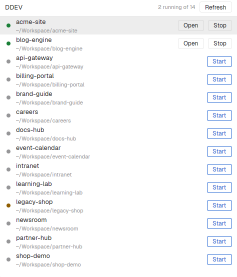
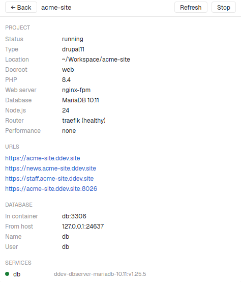

# Herdr DDEV

A [Herdr app](https://herdr.dev) mod that shows the status of your [DDEV](https://ddev.com)
projects and starts or stops them with one click.



- Lists every project from `ddev list`, with a status dot and its location.
- The project of the focused terminal's folder comes first and is highlighted, then
  running projects, then the rest.
- **Start** / **Stop** run `ddev start` / `ddev stop` in the project's folder. A spinner
  shows while it works, and a notification reports the result (or the last lines of
  ddev's error).
- **Open** opens a running project's primary URL with `xdg-open`.
- Click a project's name for what `ddev describe` says: type, PHP, web server, database,
  Node.js, router, performance mode, URLs (clickable when running), database connection
  details and services with their status and image. The database password is not shown.



The screenshots use made-up projects.

## Install

Needs the Herdr desktop app and `ddev` on your `PATH`. Linux/macOS URL opening uses
`xdg-open` (Linux); on macOS change it to `open` in `openUrl()`.

```sh
git clone https://github.com/petertornstrand/herdr-app-ddev
cp -r herdr-app-ddev/mods/ddev ~/.config/herdr-app/mods/ddev
herdr-app check ~/.config/herdr-app/mods/ddev
```

Or ask your agent: *Read ~/.config/herdr-app/AGENTS.md, then add this mod:
herdr.dev/mods/petertornstrand/herdr-app-ddev*.

Open it as a popup with the `mod.open:ddev` command, or as a side pane with
`herdr-app do pane.split --direction right --mod ddev`. To bind a key, add this under
`global` in `~/.config/herdr-app/keys.json`:

```json
"ctrl-shift-d": "mod.open:ddev"
```

## A button in the tab bar

To get a **DDEV** button next to Files and Changes, open the mod once (the popup is
enough) and run:

```sh
herdr-app do ddev.add-button
```

Herdr's own `main` layout and `tabs` mod are read-only, so this clones them as
`main-ddev` and `tabs-ddev`, adds the button and a DDEV side panel to the clones and
switches the window to the layout `main-ddev`. `ctrl-shift-l` switches back. To undo:

```sh
herdr-app do ddev.remove-button
```

It deletes the two clones and returns to the layout you came from. The clones are yours and
Herdr never updates them, so after a Herdr release that changes the tab bar or the main
layout, run `remove-button` and then `add-button`. If you already use a cloned layout
with other buttons, add the DDEV block to its `panel-body` and the button to its tab bar
by hand; `mods/ddev/setup.js` shows the two small patches.

## What it runs and reads

Mods are trusted code, so for the record: `ddev list -j`, `ddev describe <name> -j`
(every 10 seconds while open), `ddev start|stop` in a project's folder on click and
`xdg-open <url>` on click. Its one network call is the daily update check (see Updates). The only files it writes are the
ones `ddev.add-button` and `ddev.remove-button` create or delete (`layouts/main-ddev.json`,
`mods/tabs-ddev/` and `data/ddev/previous-layout.txt`, all under `~/.config/herdr-app`).

## Updates

At most once a day the mod reads `version` in this repository's `mods/ddev/mod.json` (one
GET to `raw.githubusercontent.com`; nothing is sent but the request). If it is newer than
the installed one, a banner with an **Update** button shows under the header. The button
asks the focused agent to read the new files and replace the mod, run `herdr-app check`
and tell you what changed. Nothing is updated without an agent reading it first. To stop
the daily check: `herdr-app do ddev.update-check-off` (`update-check-on` brings it back).

## License

MIT
