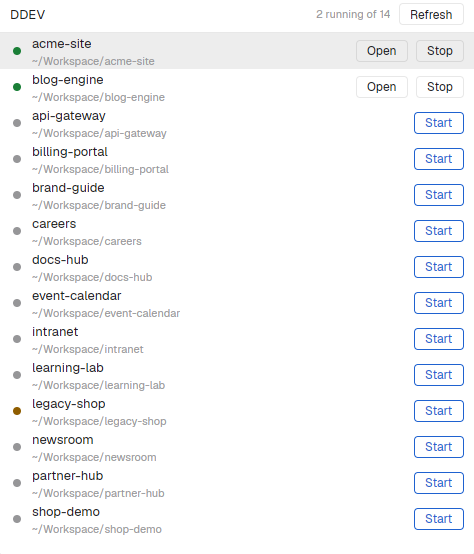

# Herdr DDEV

See which DDEV projects are running, start or stop one with a click, and read what
`ddev describe` says about it, in a popup or a side pane of the Herdr app.

## What you see

A single column, themed with Herdr's `theme()` colors, on `surface`. As a popup it is
480 px wide and 560 px tall (`mod.json` overlay: popup, top, offset 40); as a pane it
fills its block.

**List view.** A 36 px header: "DDEV" (13 px semibold), "N running of M" (11 px, dim) and a
Refresh button. Below, a scrollable list of 36 px rows, one per project from
`ddev list -j`: a status dot (green `ansi2` running, dim stopped, amber `ansi3` anything
else, a spinning `mods/workspace-chrome/spinner.svg` while starting/stopping), the name
(13 px) over its `shortroot` (11 px, dim), then buttons. Order: the project containing
the focused terminal's folder first (row background `selected`), then running projects,
then the rest, each alphabetical.

**Describe view.** The same header slot shows "← Back", the project name, Refresh and the
project's Start/Stop button. The body scrolls and has sections with 11 px uppercase dim
titles: Project (status, type, location, docroot, PHP, web server, database with version,
Node.js, router with status, performance or Mutagen, Xdebug), URLs, Database (in
container, from host, name, user) and Services (status dot, short name, image tag,
describe info). Rows with no value are left out.

## How it behaves

- Buttons: Stop when running; Start (accent border) when `stopped` or `paused`; while a
  command runs, plain text "Starting…" / "Stopping…"; any other status (for example
  ".ddev/config.yaml missing") is shown as dim text and offers no action.
- Open (running projects with a primary URL) runs `xdg-open <url>`.
- Start/Stop run `ddev start` / `ddev stop` with `cwd` set to the project's `approot` and
  a 10 minute timeout. Success posts a toast ("DDEV started: name"); failure posts an
  error toast with the last four lines of ddev's output. Afterwards the list and an open
  describe view refresh.
- Clicking the left part of a row (name and path) opens its describe view; the buttons
  do not. URLs in the describe view are accent-colored links when the project is running
  and plain dim text otherwise. Mailpit is listed when the project runs and XHGui only
  when its service runs.
- `ddev list -j` is polled every 10 seconds and, with a describe view open,
  `ddev describe <name> -j` too. Nothing is polled by `init()` during `herdr-app check`
  (guard with `checking()`).
- If `ddev` fails, the body shows the error in `ansi1`. A failing describe shows its
  error the same way.

## Built from

- `mods/ddev/mod.json`: `{ "place": "none", "title": "DDEV", "overlay": { "kind": "popup",
  "at": "top", "offset": 40, "width": 480, "height": 560 } }`.
- `mods/ddev/main.js`: one `View` subclass. `gpui-kit` (`View`, `div`, `svg`), `gpui-base`
  (`v_flex`, `h_flex`) and `herdr` (`exec`, `focused`, `notify`, `theme`, `checking`,
  `props`). Scrolling lists use `.id(...).flex_1().min_h(0).overflow_y_scrollbar()`.
- Data: `exec("ddev", ["list", "-j"])` and `exec("ddev", ["describe", name, "-j"])`. The JSON is
  the last stdout line starting with `{`; the payload is its `raw` field. List fields used:
  `name`, `status`, `approot`, `shortroot`, `type`, `primary_url`. Describe fields: `status`,
  `status_desc`, `type`, `shortroot`, `docroot`, `php_version`, `webserver_type`,
  `database_type`, `database_version`, `nodejs_version`, `router`, `router_status`,
  `mutagen_enabled`, `performance_mode`, `xdebug_enabled`, `hostnames`, `mailpit_https_url`,
  `xhgui_https_url`, `dbinfo` (`host`, `dbPort`, `published_port`, `dbname`, `username`) and
  `services` (`short_name`, `status`, `image`, `describe-url-port`, `describe-info`).
- The project for the focused terminal is the one with the deepest `approot` that is a
  prefix of `focused().cwd`.

## Watch out

- A popup is sized by its content, so with `props().overlay` set the root needs an
  explicit height (560); without one the scroll area collapses to the header. In a pane
  use `size_full()`.
- `svg` is exported by `gpui-kit`, not `herdr`.
- `mod.open` toggles: calling it again closes the popup.
- `dbinfo.published_port` is `-1` while the project is stopped: hide it.
- Never show `dbinfo.password`.
- `ddev describe` fails for a project whose folder lost its `.ddev/config.yaml`; show the
  error instead of leaving the view empty.
- Only the folder of a local terminal is matched; remote machines' spaces are not.
- `xdg-open` is Linux; macOS needs `open`.
- Clicking Start/Stop is not tested by `herdr-app check`, which only renders once.

## Done when

- `herdr-app check mods/ddev` passes and `herdr-app status` lists no errors.
- Opening the popup lists every project from `ddev list`, the focused terminal's project
  first and highlighted, with "N running of M" matching `ddev list`.
- Start on a stopped project shows "Starting…", the project turns green and a success
  toast appears; Stop reverses it.
- Clicking a project's name shows its describe view with the sections above; Back
  returns to the list; a stopped project shows no host port; a project without
  `.ddev/config.yaml` shows ddev's error.
- No database password appears anywhere.
